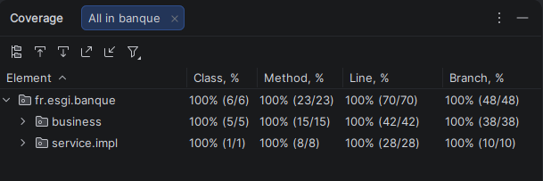

# Rendu : tests unitaires et TDD

- **Nom** : PASSY BASSOUAMINA
- **Prénom** : Premice Axel
- **Promotion** : B3
- **Campus** : ESGI Reims

## Partie A : défauts trouvés

| Règle   | Description du défaut  | Test qui le prouve                                                                           |
|---------|------------------------|----------------------------------------------------------------------------------------------|
| C3      | `crediter` acceptait un montant nul (`signum() < 0` au lieu de `<= 0`). | `CompteTest.shouldRejectCreditWhenAmountIsNotStrictlyPositive` (cas `0` et `0.00`)           |
| C5      | Un débit qui amenait le solde exactement à `-découvertAutorisé` était refusé (`<= 0` au lieu de `< 0`). | `CompteTest.shouldAcceptDebitUpToOverdraftLimit` (cas `300.00 -> -200.00`)                   |
| C6      | `estVide()` utilisait `equals`, qui compare aussi l'échelle : un solde de `0.00` n'était pas considéré comme vide. Remplacé par `compareTo`. | `CompteTest.shouldBeEmptyOnlyWhenBalanceIsZero` (cas `0.00`)                                 |
| F3      | La tenue de compte était offerte jusqu'à 26 ans inclus (`<=` au lieu de `<`). | `CalculFraisTest.shouldOfferAccountFeeOnlyUnder26` (cas `26 ans -> 2.00`)                    |
| F4      | La tenue n'était offerte qu'au-dessus de 1 000 € (`> 0` au lieu de `>= 0`) : un solde moyen d'exactement 1 000 € payait les frais. | `CalculFraisTest.shouldOfferAccountFeeFrom1000EurosAverageBalance` (cas `1000` et `1000.00`) |
| F5      | Quand la tenue était offerte, la méthode renvoyait `0` directement et oubliait le supplément premium de 5,00 €. | `CalculFraisTest.shouldAlwaysChargePremiumCardSupplement` (cas `20 ans` et `solde 1000`)     |

Les règles C1, C2, C4, C7, F1 et F2 étaient respectées : leurs tests passent sans correction.

## Couverture de code (IntelliJ, Run with Coverage)

## Partie B : règles non terminées

Aucune : les règles V1 à V7 sont traitées en TDD (cycles `red:` / `green:` / `refactor:` dans l'historique git).
